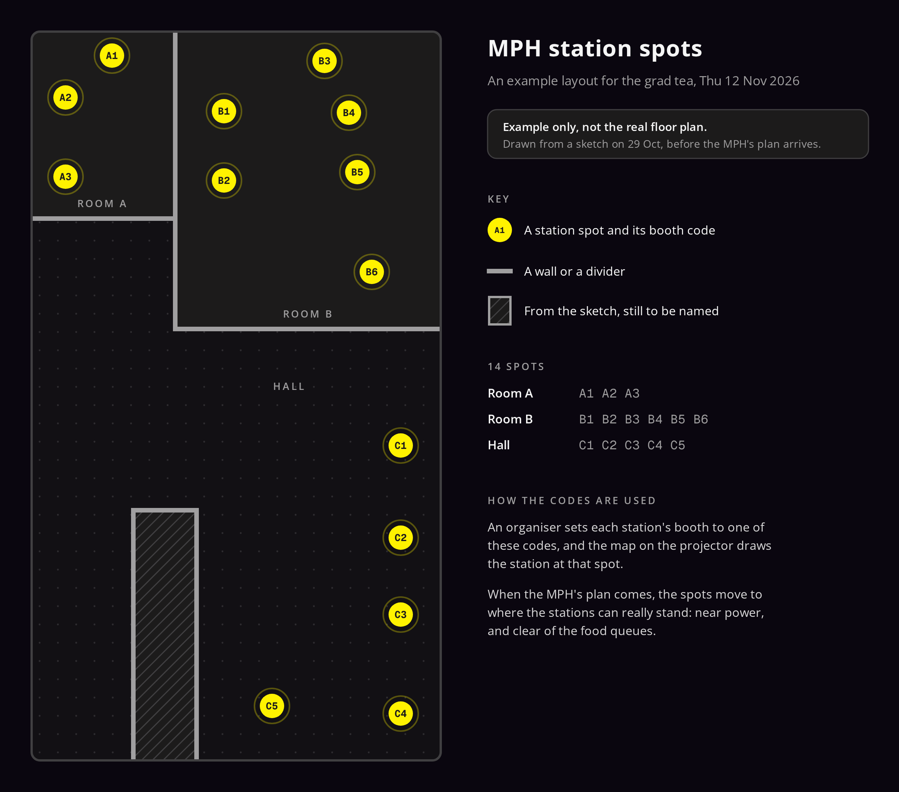

# The MPH for the grad tea

Notes for BAC-95, where we agree the MPH requests with Mr Yaseer.

## Example floor plan

`example-floor-plan.svg` is an example layout for the grad tea on Thu 12 Nov 2026, drawn from
Adam's sketch on 29 Oct. It is not the MPH's real floor plan, which hasn't arrived yet.
`example-floor-plan.png` is the same drawing as an image, posted on BAC-95 to show Mr Yaseer.

It has 14 station spots, each with a booth code:

| Area | Booth codes |
|---|---|
| Room A | A1, A2, A3 |
| Room B | B1, B2, B3, B4, B5, B6 |
| Hall | C1, C2, C3, C4, C5 |

The hatched shape in the hall comes from the sketch and has no name yet.

A station's booth is free text (agreement 9.12), so an organiser sets it to one of these codes,
and the map on the projector (FRO-78) draws the station at that spot. FRO-78 gives the map its own
copy of the spots in `apps/event-web`. When the real plan comes, both change together: the spots move
to places with power that are clear of the food queues, and the codes stay where they can.

To make the PNG again after editing the SVG, open the SVG in Chromium with Open Sans and Geist
Mono loaded (the Event screens' fonts) and take a screenshot at 1180 by 1040, at twice the scale.
